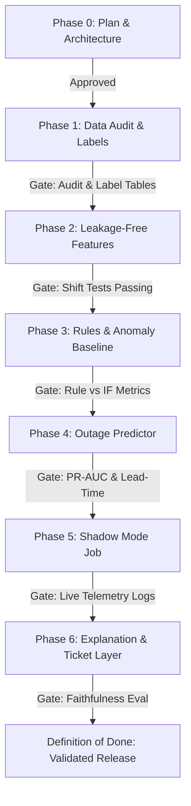

# Phase 0 Implementation Plan: ThingsBoard Telemetry Anomaly Detection & 24-Hour Outage Prediction

**Project:** Bank Branch Telemetry Anomaly Detection & 24h Outage Prediction System  
**Target Fleets:** State Bank of India (SBI), Bank of India (BOI), Bank of Baroda (BOB), Canara Bank  
**Author:** Senior ML Engineering Pair  
**Status:** Phase 0 Complete — Awaiting User Approval to Proceed to Phase 1  

---

## 1. Executive Summary & Core Principle

This project builds an end-to-end, reproducible, leakage-free anomaly detection and 24-hour outage prediction system for bank branch IoT gateways connected to ThingsBoard.

**Core Principle:** *Simple, validated, reproducible beats complex and unverified.*
- Every metric, sample count, and table reported must originate from executed code.
- Data processing and feature engineering are strictly leakage-free (point-in-time enforcement).
- The existing fine-tuned Qwen reasoning model (`models/qwen_reasoning_outage_predictor/final_model/`) is strictly restricted to an **explanation and ticket synthesis layer**. It will never be used to predict probabilities or risk tiers directly.
- Strict phase gates are observed: no phase starts without verified approval of the preceding phase.

---

## 2. Target Fleet & Signal Matrix

From our live inspection of the ThingsBoard tenant (`https://seple.iot-private.cloud`) and registry, the device distribution across bank branches is:

| Bank Prefix / Fleet | Devices Discovered | Active Profile Identifier | Key Operational Context |
| :--- | :---: | :--- | :--- |
| **BOI** | 104 | `BOI Device Profile` | Largest deployed fleet; primary training volume |
| **SBI** | 16 | `SBI Hestia` | High-priority branches; strict SLA |
| **BOB** | 10 | `HESTIA` / `BOB test` | Branch & ATM sites |
| **CANARA** | 5 | `Canara Bank Profile` | Emerging deployment |
| *Exclusions / Staging* | 26 | `RND Test`, `playback`, etc. | Must be filtered out via `DevicePolicy` |
| **Total Fleet** | **161** | — | **~135 Production Bank Branches** |

### Signal Mapping to ThingsBoard Telemetry Keys

Based on key discovery across the tenant's registry, the required signals map to the following active keys:

| Target Physical Signal | Primary Telemetry Keys | Fallback / Variant Keys | Units & Normal Range |
| :--- | :--- | :--- | :--- |
| **AC Line Voltage** | `ac_voltage`, `ac_status` | `ac_result`, `statusbox_mains_on` | Volts ($180 - 250\text{ V}$) |
| **Battery Voltage & %** | `battery_voltage`, `battery_status` | `statusbox_battery_low`, `statusbox_battery_reverse` | Volts ($10.8 - 14.4\text{ V}$) / % |
| **Mains State** | `statusbox_mains_on`, `power_off_last` | `ac_status == 0` | Binary ($1 = \text{ON}, 0 = \text{OFF}$) |
| **NVR / DVR Status** | `Nvr_DVR_last`, `dvr_nvr_off` | `Hikvision_NVR_Heartbeat`, `DahuaNVR_Heartbeat` | Timestamp / Binary / Heartbeat |
| **Fire Alarm System (FAS)** | `fasLastHour`, `fasUptime` | `fire_alarm_off_last`, `fire_alarm_activate_last`, `FASfaultCOUNT` | Status / Counter / Fault Flag |
| **Storage / Disk Health** | `hdd_error_last`, `disk` | `hddError`, `watchdog_log` | Error count / % usage / status |
| **Device Heartbeat / Online** | `uptimeHeartbeat`, `gatewayUptime` | `heartbeat`, `lastActivityTime`, `active` | Epoch ms / Counter / Boolean |
| **Alarm Severity Stream** | `alarms.csv` stream | `CRITICAL`, `MAJOR`, `WARNING` counts | Event counts in rolling window |

---

## 3. Project Directory Structure

The repository will adhere strictly to the target layout:

```text
Data_scrapping_thgingsboard_ml-intern/
├── configs/
│   └── config.yaml               # All thresholds, keys, windows, hyperparameters
├── data/
│   ├── raw/                      # Untouched Parquet files from ThingsBoard API
│   └── processed/                # Resampled, leakage-free feature matrices & labels
├── src/
│   ├── ingest/                   # Robust paginated telemetry & alarm pullers
│   ├── features/                 # Point-in-time feature extraction & gap encoding
│   ├── rules/                    # Deterministic thresholds (AC, battery, heartbeat)
│   ├── anomaly/                  # Unsupervised Isolation Forest (per-group)
│   ├── predict/                  # Outage classifiers (Logistic Regression, LightGBM)
│   ├── explain/                  # Qwen reasoning wrapper & numerical hallucination validator
│   └── eval/                     # Calibration, PR-AUC, lead-time & bootstrap CI tools
├── notebooks/                    # Exploratory & audit scratchpads
├── reports/                      # Artifacts, audit summaries & data cards
├── tests/                        # Strict unit tests (shift tests, no future leakage)
├── models/
│   ├── qwen_reasoning_outage_predictor/final_model/  # Existing explanation asset
│   ├── isolation_forest/         # Phase 3 anomaly baselines
│   └── gbm_outage/               # Phase 4 classifiers
└── README.md                     # Single-command reproduction & system documentation
```

---

## 4. Phase-by-Phase Roadmap & Exit Criteria



### Phase 1: Data Audit and Labels
1. **Ingestion Engine (`src/ingest/`):**
   - Paginated, resilient extraction with bounded exponential backoff, rate-limit jitter, and atomic Parquet serialization.
   - Raw data stored untouched under `data/raw/telemetry/` and `data/raw/alarms/`.
   - Window: **90 days** (confirmed by user).
2. **Audit Reporting (`reports/phase_1_data_audit.md`):**
   - Device inventory grouped by bank (SBI, BOI, BOB, Canara).
   - Sampling intervals, % missingness, gap distribution, clock drift, duplicate timestamps.
   - Signal distributions, physical units, and outlier bounds.
3. **Formal Outage Label Definition:**
   - Formalized in `configs/config.yaml`:
     $$\text{Outage} = (\text{mains\_lost} == 1) \land (\text{battery\_voltage} < 10.8\text{ V} \lor \text{NVR\_offline} == 1) \text{ sustained for } \ge 15\text{ minutes}$$
   - Independent cross-check against ThingsBoard alarm history (`POWER OFF`, `BATTERY LOW`, `DVR/NVR OFF`).
4. **Sample Size Gate Check:**
   - Calculate number of independent outage events.
   - **Decision Gate:** If independent outage events $< 30$, halt supervised modeling and recommend Rules + Anomaly Detection track.

### Phase 2: Features (Strict Zero-Leakage Engine)
1. **Resampling:** Uniform interval (15-min fixed grid).
2. **Explicit Gap Encoding:** Never silently forward-fill gaps. Missingness is captured as explicit features (`heartbeat_gap_seconds`, `telemetry_age_seconds`, `missing_flag`).
3. **Point-in-Time Features at Anchor $t$ (data $\le t$ only):**
   - AC voltage: 1h, 6h, 24h rolling mean, std, min, max, slope.
   - Battery voltage & discharge rate: rolling statistics and $\Delta V / \Delta t$.
   - Mains event history: time since last mains loss, 7-day cumulative mains loss count.
   - Alarms: rolling counts by severity (Critical, Major, Warning) over 1h, 6h, 24h.
   - Fault flags: NVR offline flag, FAS fault flag, storage error count.
   - Cyclical temporal features: hour of day, day of week.
   - Normalization: Per-device z-scores computed strictly from that device's prior window.
4. **Verification & Tests:**
   - Unit tests in `tests/test_features_no_leakage.py` enforcing that shifting future data by $+1\text{s}$ does not alter feature values at anchor $t$.

### Phase 3: Rules and Anomaly Baseline
1. **Deterministic Rules Engine (`src/rules/`):**
   - Hard thresholds: $AC = 0\text{ V}$, $AC > 250\text{ V}$, $\text{battery} < 10.8\text{ V}$, $\text{mains disconnected}$, $\text{heartbeat gap} > \text{threshold}$, $\text{storage fault} == 1$.
2. **Unsupervised Anomaly Model (`src/anomaly/`):**
   - Isolation Forest fitted on strictly normal baseline windows per bank group.
   - Generates continuous anomaly score + SHAP/TreeSHAP local feature contribution ranking.
3. **Baseline Metrics Evaluation:**
   - Precision, Recall, False Alarms per device per week, and Lead Time before outage onset.
   - Optional LSTM Autoencoder only if Isolation Forest demonstrates clear failure modes.

### Phase 4: Outage Predictor (24h Lead Time)
1. **Purged Chronological & Grouped Splits:**
   - Temporal partition: Early period $\to$ Train; Middle period $\to$ Validation; Latest period $\to$ Test.
   - Out-of-sample device holdout: Entire bank branches reserved for generalization testing.
2. **Model Progression:**
   - Level 0: Deterministic Rules Baseline.
   - Level 1: Logistic Regression with balanced class weights.
   - Level 2: LightGBM with cost-sensitive objective and hyperparameter tuning on validation set only (install approved).
3. **Comprehensive Test Set Reporting:**
   - Confusion matrix, Precision, Recall, F1, PR-AUC, Calibration Curve (Brier score, Platt/Isotonic scaling).
   - Mean lead time before failure, alert volume per device per week, bootstrap 95% confidence intervals.
   - SHAP feature importances and error breakdown on false positives and misses.

### Phase 5: Shadow Mode Monitoring
1. Scheduled pipeline job running every 15 minutes.
2. Ingests latest telemetry window, evaluates rules and ML predictor, logs predictions to append-only JSON/database log.
3. Optional emission to ThingsBoard as non-alarm telemetry (e.g., `outage_risk_score`).
4. Strict constraint: **Zero automated field dispatches.**

### Phase 6: Explanation & Ticket Generation Layer
1. **Qwen Model Role:**
   - Solely an explanation generator translating structured outputs (anomaly score, outage probability, top 3 contributing features, active rule flags, physical telemetry readings) into natural language field diagnosis and dispatch recommendations.
   - Never outputs or modifies the numerical probability or risk tier.
2. **Strict Numerical Hallucination Guard (`src/explain/validator.py`):**
   - Regex-based numerical scanner parses every integer and float in Qwen's text output.
   - Validates that every extracted number exists within the structured input payload (or tolerance).
   - If validation fails, immediately fall back to a deterministic, Jinja-based template.
3. **Faithfulness Evaluation:**
   - Evaluated over $\ge 100$ real test cases (including borderline/noisy cases), with 30 cases undergoing manual review.
   - Retraining on genuine model outputs from Phase 4 to replace the earlier synthetic dataset.

---

## 5. Risk Assessment & Mitigation Matrix

| Identified Risk | Severity | Impact | Mitigation Strategy |
| :--- | :---: | :--- | :--- |
| **Insufficient Outage Labels ($< 30$ events)** | **High** | Supervised LightGBM model will overfit or fail to generalize. | Enforce Phase 1 gate: if $< 30$ events, halt supervised training and ship robust Rules + Isolation Forest anomaly detection. |
| **Telemetry Signal Sparsity** | **Medium** | Missing keys across older device firmware versions. | Explicit missingness features + separate feature pipelines for legacy vs. statusbox firmware keys. |
| **Temporal Data Leakage** | **Critical** | Overly optimistic metrics that collapse in production. | Shift test unit test suite; point-in-time calculation with anchor timestamp assertions. |
| **Heavy Dependency Incompatibility** | **Medium** | `lightgbm` or `shap` installation issues on Windows Python 3.13. | Pre-build / pip wheels verified in virtual environment. |
| **LLM Numerical Hallucination** | **High** | Misleading field engineers with incorrect voltage or battery readings. | Strict input-output number matcher; zero-tolerance fallback to deterministic templates. |

---

## 6. Confirmed Parameters & Gate Alignment

1. **Historical Telemetry Window:** **90 days** (confirmed by user).
2. **Outage Label Definition:** **Mains Lost $\land$ (Battery $< 10.8\text{ V} \lor \text{NVR Offline}$) sustained for $\ge 15\text{ minutes}$** (confirmed by user).
3. **Dependencies:** `lightgbm` and `shap` approved for installation in `.venv` for Phase 2/4.
4. **Current Status:** Phase 0 complete. System is stopped and waiting for explicit user approval before launching Phase 1.
